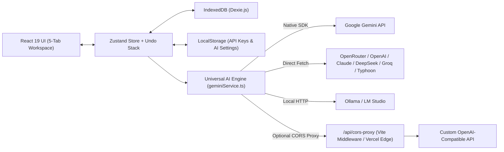

# System Architecture & Data Schema

เอกสารนี้อธิบายสถาปัตยกรรมทางเทคนิค โครงสร้างข้อมูล (`schemaVersion: 3`) และกลไกการประหยัด Token ของ **PlotCraft TH**

---

## 1. ภาพรวมสถาปัตยกรรม (High-Level Architecture)



### หลักการออกแบบสำคัญ
1. **Local-First Persistence:** โปรเจกต์ทั้งหมดเก็บใน IndexedDB (`ThaiNovelOutlinerDB`) ผ่าน Dexie.js ทำให้รองรับข้อมูลนิยายขนาดใหญ่ได้หลายสิบเรื่องโดยไม่ติดขีดจำกัด 5 MB ของ LocalStorage
2. **Per-Provider Key Isolation:** `LocalStorage` เก็บ API Key เป็นแผนที่ `Record<presetId, apiKey>` ทำให้สลับค่ายไปมาได้โดยไม่ต้องกรอกคีย์ใหม่
3. **Runtime Safety:** ผลลัพธ์ JSON จากทุก AI Provider จะถูกสกัดด้วย `extractJsonText()` และตรวจสอบความถูกต้องผ่าน **Zod** ก่อนส่งกลับเข้า Store เสมอ

---

## 2. โครงสร้างข้อมูลมาตรฐาน (`schemaVersion: 3`)

อ้างอิงจาก [src/types/novel.ts](../src/types/novel.ts):

```json
{
  "schemaVersion": 3,
  "projectId": "uuid-v4",
  "metadata": {
    "title": "ชื่อเรื่องนิยาย",
    "genres": ["แฟนตาซี", "สืบสวนสอบสวนและระทึกขวัญ"],
    "structureTemplate": "Save the Cat!",
    "tone": "จริงจังและระทึกขวัญ",
    "targetAudience": "วัยรุ่น / Young Adult (YA)",
    "targetChapterCount": 20,
    "seedIdea": "ไอเดียตั้งต้นของผู้เขียน",
    "writingStyle": {
      "pov": "บุรุษที่ 3 (ผู้เล่าเรื่อง)",
      "proseStyle": "กระชับ อ่านไว สไตล์เว็บโนเวล",
      "chapterLength": "medium",
      "styleAnchor": "ตัวอย่างสำนวนเปิดเรื่องที่ผู้เขียนเลือก"
    },
    "createdAt": "ISO-8601",
    "updatedAt": "ISO-8601"
  },
  "macroOutline": {
    "logline": "ประโยคสรุปแก่นเรื่องและปมหลัก",
    "worldBuilding": [
      {
        "id": "wb-1",
        "category": "กฎของโลก / ระบบพลัง",
        "detail": "รายละเอียด",
        "isPinned": true
      }
    ],
    "characters": [
      {
        "id": "char-1",
        "name": "ชื่อตัวละคร",
        "role": "ตัวเอก",
        "archetype": "บทบาทตามทฤษฎี",
        "goal": "เป้าหมายหลัก",
        "flaw": "จุดอ่อน/ปมในใจ",
        "background": "ภูมิหลังย่อ",
        "relationships": "ความสัมพันธ์กับตัวละครอื่น",
        "isPinned": true
      }
    ],
    "plotBeats": [
      {
        "id": "beat-1",
        "beatName": "Catalyst",
        "act": "องก์ที่ 1",
        "summary": "สรุปเหตุการณ์"
      }
    ]
  },
  "rollingSummary": "สรุปเหตุการณ์สะสมแบบกระชับ (<= 250 คำ)",
  "chapters": [
    {
      "chapterNumber": 1,
      "title": "ชื่อตอน",
      "linkedBeat": "Opening Image",
      "goal": "เป้าหมายในตอน",
      "conflict": "อุปสรรค/ความขัดแย้ง",
      "outcome": "ผลลัพธ์",
      "cliffhanger": "จุดทิ้งท้าย",
      "summary": "สรุปเหตุการณ์ย่อ",
      "content": "เนื้อหานิยายฉบับเต็ม (Stage 3)"
    }
  ]
}
```

---

## 3. สถาปัตยกรรมลดการใช้ Token (6-Layer Token Optimization)

| กลไก | ไฟล์ที่รับผิดชอบ | ผลลัพธ์โดยประมาณ |
| :--- | :--- | :--- |
| **1. Smart Context Pruning** | `buildStaticCanonPrefix()`, `buildRelevantBeatsWindow()` | ลด Input Token 40–60% โดยส่งเฉพาะ 3 Beat ที่เกี่ยวข้อง + โปรไฟล์เต็มเฉพาะตัวเอกและตัวละครที่ถูกกล่าวถึงในตอน |
| **2. Highlight-to-Refine** | `refineSelectedProse()`, `WriterTab.tsx` | ลด Token การแก้ไขเนื้อเรื่อง 80–90% โดยส่งเฉพาะข้อความที่ลากคลุม + บริบทหน้า/หลัง 280 ตัวอักษร |
| **3. Prompt Caching Layout** | `geminiService.ts` | จัดวาง Static Canon + Style Anchor ไว้ด้านบนสุดในลำดับคงที่ เพื่อให้เข้าเงื่อนไข Prompt Caching (ลดค่า Input ซ้ำ 50–90%) |
| **4. Dual-Model Routing** | `withFastModel()` | แยกงานเบา (Auto-Director, Logline, เพิ่ม Lore/ตัวละคร, บีบอัดสรุป) ไปใช้ `fastModel` ลดค่า API 50–70% |
| **5. Compact System Prompts & Summary Cap** | `BASE_SYSTEM_INSTRUCTION`, `compressRollingSummary()` | เขียนกฎระบบเป็นภาษาอังกฤษกระชับ (บังคับคำตอบไทย) และจำกัด/บีบอัด Rolling Summary ไม่ให้บวม |
| **6. Token Estimator & Economy Mode** | `tokenEstimator.ts`, `Workspace.tsx` | ประมาณการ Token ภาษาไทย/อังกฤษแบบเรียลไทม์ เตือนเมื่อปักหมุดเกิน 10 การ์ด และลด Batch จาก 5 เหลือ 3 ตอน |

---

## 4. Universal AI Adapter & Fallback Flow

1. **Google Gemini (`provider: 'gemini'`):** ใช้ `@google/genai` พร้อม `responseMimeType: "application/json"`, `responseSchema`, และ `safetySettings` ระดับ `BLOCK_ONLY_HIGH` สำหรับงานนิยาย
2. **OpenAI-Compatible (`provider: 'openai-compatible'`):** ส่ง `POST /chat/completions` พร้อม `response_format: { type: "json_object" }` และแนบ `jsonContract` ใน Prompt หากปลายทางคืน `400` เพราะไม่รองรับ `response_format` ระบบจะ Fallback ส่งซ้ำโดยไม่ใส่ฟิลด์นั้นอัตโนมัติ
3. **Anthropic Claude (`provider: 'anthropic'`):** ส่ง `POST /messages` พร้อม Header `anthropic-dangerous-direct-browser-access: true` และ `anthropic-version: 2023-06-01`
